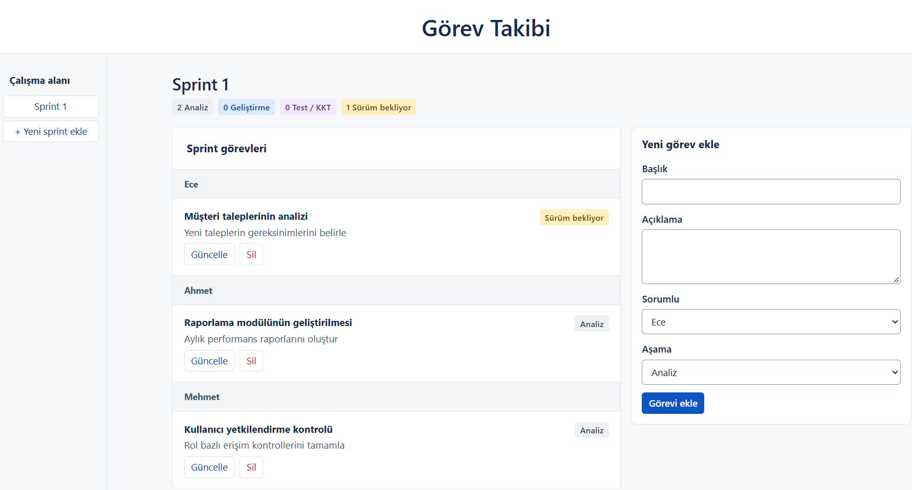

# TaskFlow · Sprint Görev Takibi

[](https://github.com/ececivaa/taskflow-web/actions/workflows/ci.yml)

Küçük ekipler için sprint bazlı görev takip uygulamasının web arayüzü. Görevler sprintlere ayrılır, sorumlu kişiye göre gruplanır ve
**Analiz → Geliştirme → Test / KKT → Sürüm bekliyor** aşamalarında izlenir.

<!-- Ekran görüntüsü: docs/screenshot.png dosyasını ekledikten sonra aşağıdaki satırın yorumunu kaldırın. -->
<!--  -->

## Özellikler

- Görev ekleme, güncelleme ve onaylı silme (REST API üzerinden)
- Birden fazla sprint oluşturma ve sprintler arasında geçiş
- Görevlerin sorumlu kişiye göre gruplanması ve aşama bazlı özet sayaçlar
- Yükleme, kaydetme ve silme hataları için anlaşılır mesajlar; API silmeyi desteklemiyorsa bunu ayrıca belirtir
- Erişilebilirlik: anlamlı başlık hiyerarşisi, `aria-pressed` / `aria-live` / `role="alert"` kullanımı, tamamen klavyeyle kullanılabilir formlar

## Teknolojiler

| Alan | Kullanılan |
| --- | --- |
| Arayüz | React 19, TypeScript |
| Derleme | Vite |
| Test | Vitest, Testing Library, jsdom |
| Kod kalitesi | oxlint, TypeScript tip kontrolü |
| CI | GitHub Actions (lint → test → build) |

## Mimari

```
src/
├── App.tsx               # Sayfa düzeni ve ekran durumu (aktif sprint, düzenlenen görev)
├── types.ts              # Ortak tipler ve sabitler (aşamalar, ekip üyeleri)
├── hooks/useTasks.ts     # Görevlerin yüklenmesi ve CRUD işlemleri
├── lib/api.ts            # REST API istemcisi
├── lib/storage.ts        # Tarayıcıda tutulan sprint/aşama/sorumlu bilgisi
└── components/           # SprintNav, StageSummary, TaskList, TaskForm
```

- **Veri akışı:** `useTasks` API çağrılarını ve meşgul (`busy`) durumunu yönetir; bileşenler yalnızca props ve callback alır.
- **Formlar kontrolsüz (uncontrolled):** `TaskForm`, sprint veya düzenlenen görev değiştiğinde `key` ile yeniden oluşturulur,
  böylece alanlar ve hata mesajları ek state yönetimine gerek kalmadan sıfırlanır.
- **İstek iptali:** İlk yüklemede `AbortController` kullanılır; bileşen kaldırılırsa yarım kalan istek state güncellemez.

### Bilinçli bir ara çözüm

Backend şu an görevin yalnızca başlığını, açıklamasını ve tamamlanma durumunu saklıyor. **Aşama, sorumlu ve sprint** bilgileri
API bu alanları destekleyene kadar `localStorage`'da tutuluyor. Anahtar, görev id'si ile oluşturulma zamanından üretildiği için
silinip aynı id ile yeniden oluşturulan bir görev eski bilgileri devralmaz. Bu alanlar backend'e taşındığında yalnızca
`lib/storage.ts` ve `useTasks` değişecek.

## Kurulum

Gereksinimler: Node.js 20.19+ (CI'da 24 kullanılıyor)

```bash
npm install
npm run dev
```

Geliştirme sunucusu `/api` isteklerini `https://localhost:7295` adresindeki backend'e yönlendirir (bkz. `vite.config.ts`).
Uygulamanın görev verisi gösterebilmesi için backend'in bu adreste çalışıyor olması gerekir.

### API sözleşmesi

| Yöntem | Yol | Açıklama |
| --- | --- | --- |
| `GET` | `/api/tasks` | Tüm görevleri döndürür |
| `POST` | `/api/tasks` | `{ title, description, isCompleted }` ile görev oluşturur, oluşan görevi döndürür |
| `PUT` | `/api/tasks/{id}` | Görevi günceller |
| `DELETE` | `/api/tasks/{id}` | Görevi siler |

## Komutlar

| Komut | Açıklama |
| --- | --- |
| `npm run dev` | Geliştirme sunucusu |
| `npm test` | Testleri bir kez çalıştırır |
| `npm run test:watch` | Testleri izleme modunda çalıştırır |
| `npm run lint` | oxlint ile statik analiz |
| `npm run build` | Tip kontrolü ve üretim derlemesi |

## Testler

- `src/lib/storage.test.ts`: tarayıcı depolamasındaki bozuk/geçersiz verinin güvenli şekilde ele alınması
- `src/App.test.tsx`: sahte (mock) API ile uçtan uca kullanıcı akışları: yükleme, hata, ekleme, güncelleme, silme ve sprint oluşturma

## Yol haritası

- [ ] Aşama, sorumlu ve sprint bilgisini backend'e taşımak
- [ ] Ekip üyelerini API'den almak
- [ ] Aşamalar arasında sürükle-bırak (kanban görünümü)
- [ ] Canlı demo
